# xpro-oss

[](https://pkg.go.dev/github.com/bluefunda/xpro-oss)
[](https://github.com/bluefunda/xpro-oss/actions/workflows/ci.yml)
[](https://goreportcard.com/report/github.com/bluefunda/xpro-oss)
[](https://github.com/bluefunda/xpro-oss/releases)
[](go.mod)
[](LICENSE)
[](https://github.com/bluefunda/xpro-oss/pkgs/container/xpro-oss)
[](https://www.conventionalcommits.org)
[](.github/dependabot.yml)

A generic, config-driven XML ingestion daemon: read files from a source, map
configured XPath expressions onto columns, and batch-insert the result into
a target database (PostgreSQL, Oracle or SAP HANA). There is no built-in XML schema, source location, or
vendor-specific concept anywhere in this repo — every field is driven by
`config.yaml`.

xpro-oss is a from-scratch, minimal XML ingestion service built on the
`github.com/bluefunda/btp-go` libraries and BlueFunda conventions, and it uses
the batched-insert/savepoint-isolation pattern proven in production at BlueFunda,
generalized so it isn't tied to any particular XML shape or SAP concept.

---

## Documentation

| | |
|---|---|
| [docs/RUNNING.md](docs/RUNNING.md) | **Start here to run it**: Docker image, Compose stacks, your own database, triggering runs, tuning, troubleshooting |
| [examples/](examples) | Ready-to-run Docker Compose stacks (PostgreSQL, Oracle, SAP HANA) with `config.yaml`, `schema.sql` and sample XML |
| [docs/BENCHMARKS.md](docs/BENCHMARKS.md) | Throughput on each database (files/s, memory, concurrency, 300K / 1M-file estimates) and how to reproduce |
| [docs/HANA_DOCKER.md](docs/HANA_DOCKER.md) | Running SAP HANA express in Docker for testing |
| [THIRD_PARTY_LICENSES](THIRD_PARTY_LICENSES) | Licenses of bundled dependencies |
| [AGENTS.md](AGENTS.md) | Contributor / coding-agent guide: layout, conventions, release process |

---

## Architecture



**Processing flow**, per `POST /process`:

```
fs.ReadDir(source)
    │
    ▼
split into N-row batches (DB-aware default: 500 postgres / 150 oracle / 500 hana)
    │  one goroutine per batch, bounded worker pool (default 8)
    ▼
for each batch: fs.ReadFile → parser.Parse (config-driven mapping)
    files that can't be read or parsed are counted in `failed` (with their error)
    │
    ▼
Inserter.InsertBatch
    one transaction, one prepared statement, reused across the batch
    per-row isolation: SAVEPOINT / ROLLBACK TO SAVEPOINT (postgres, oracle)
                       or native statement-level rollback (hana)
    transient whole-batch failures (dropped connection, timeout) retry once, inline;
    server errors and uncertain commits are never retried
```

### Per-row isolation (SAVEPOINT)

One malformed or constraint-violating row must not sink the other rows in its
batch. Every driver gives that guarantee, by the mechanism its database supports:

| Target | Mechanism | Why |
|---|---|---|
| PostgreSQL | `SAVEPOINT sp_N` before each row; `ROLLBACK TO SAVEPOINT sp_N` if that row's INSERT fails | A failed statement aborts a Postgres transaction until rolled back to a savepoint |
| Oracle | Same as PostgreSQL | Savepoints are the standard way to undo one statement and continue |
| SAP HANA | **No savepoints.** A failing INSERT is rolled back by HANA at statement level; the loop records the failure and continues | HANA has no `SAVEPOINT` statement, and its transaction stays usable after a failed statement |

The shared implementation is `Inserter.InsertBatch` in `db/db.go`; the dialect's
`Savepoints` flag selects the mechanism (`true` for Postgres/Oracle, `false` for
HANA). Failed rows are reported in `Result.Errors`, named by source file; the
rest of the batch commits. Only *whole-transaction* failures that look transient
(`db.Retryable`: dropped or refused connection, EOF, network timeout) trigger the
single inline retry. A batch with per-row failures is never retried, since
re-running it would collide with the rows that already committed, and neither is
a failed `COMMIT` (its outcome is unknown — the server may have applied it, so a
retry could insert the batch twice) or a server-side error such as a missing table.

All three paths are covered by unit tests against a fake `database/sql` driver, and
were also run end to end against live PostgreSQL 16, Oracle Database Free 23ai and
SAP HANA express 2.00.088 (see [docs/BENCHMARKS.md](docs/BENCHMARKS.md) and the
[Compose examples](examples)); live databases are not part of CI. Every file is accounted
for: `inserted + failed == files`. Unreadable or unparseable files and batch-level
failures (for example a refused connection) are counted in `failed` and listed in
`Result.Errors` (capped at 100 entries; `errorsOmitted` counts the rest).

---

## Config file — `config.yaml`

```yaml
source:
  type: local              # "local" or "sftp"
  path: "./data/in"

  sftp:
    host: ""                # direct connection — no BTP required
    port: "22"
    user: ""
    password: "${SFTP_PASSWORD}"
    privateKeyPath: ""
    knownHosts: ""           # path to an OpenSSH known_hosts file; empty = host keys NOT verified (warns)
    # destination: "MY_SFTP_DESTINATION"   # OR resolve via SAP BTP Destination Service

target:
  db: postgres              # "postgres" (default), "oracle" or "hana" — all pure Go, no CGO
  table: "public.records"
  batchSize: 0               # 0 = DB-aware default
  # destination: "MY_DB_DESTINATION"   # Oracle and HANA only: resolve via SAP BTP Destination
  #                                      # Service instead of the fields below; tunnels
  #                                      # through BTP Connectivity when OnPremise
  host: "localhost"
  port: 5432
  user: "xpro"
  password: "${DB_PASSWORD}"
  database: "xpro"
  schema: "public"
  sslmode: "disable"

workers: 8

mapping:
  - column: account_number
    xpath: "/Root/Account/Number"
  - column: amount
    xpath: "/Root/Billing/Amount"
  - column: raw_xml
    xpath: ""                # empty xpath = store the raw file content
```

`${VAR}` references in any string value are expanded from the process environment
after the file is parsed, so a value containing quotes or newlines cannot change
the document structure; a reference to an unset variable expands to an empty
string and logs a warning. Unknown keys are rejected (a typo such as `xpth:` is an
error, not a silent change of behavior). A mapping with `const:` always stores
that value — even an empty one — while a mapping with neither `xpath` nor `const`
stores the raw file.

For SFTP, set `source.sftp.knownHosts` to an OpenSSH `known_hosts` file to verify
the server's host key. When it is empty, host keys are **not** verified and a
warning is logged on every connect.

---

## HTTP endpoints

| Method | Path | Description |
|---|---|---|
| `GET` | `/healthz` | Liveness probe |
| `GET` | `/readyz` | Readiness probe: 200 when the target database answers a ping, else 503 |
| `POST` | `/process[?limit=N][&wait=true]` | Start one source → target pass. Returns `202` and runs in the background; with `wait=true` it blocks and returns the result. Only one run at a time: a second request gets `409` |
| `GET` | `/status` | Whether a run is in progress, and the result of the last finished run |

A run belongs to the service, not to the HTTP request: a client that disconnects
does not cancel it, while SIGTERM does (the partial result is recorded in
`/status`). Runs are limited to 30 minutes.

---

## Deployment

xpro-oss is a single static-ish Go binary plus a YAML config file — it has
no hard dependency on any cloud platform. SAP BTP integration (SFTP tunneled
through the BTP Connectivity SOCKS5 proxy, credentials resolved via the BTP
Destination Service) is entirely optional and only activates when a BTP
Connectivity + Destination service binding is present in the environment.

### AWS / GCP / bare metal

```bash
go build -o xpro-oss .
./xpro-oss   # reads ./config.yaml, listens on :8080
```

Run it as a container (ECS, Cloud Run, GKE) or a `systemd` unit on a plain
VM — see `Dockerfile`. The PostgreSQL, Oracle and HANA targets are all pure Go
(no CGO, no Oracle Instant Client, no HANA client) — `CGO_ENABLED=0` covers
everything.

### Quick start with Docker Compose

Turn-key stacks for PostgreSQL, Oracle and SAP HANA (database + schema
migration + xpro-oss) are in [`examples/`](examples); the full guide —
configuration, triggering runs, tuning, troubleshooting — is
[docs/RUNNING.md](docs/RUNNING.md). Benchmarks: [docs/BENCHMARKS.md](docs/BENCHMARKS.md).

```bash
cd examples/postgres && cp .env.example .env   # set DB_PASSWORD
docker compose up -d
curl -X POST "localhost:8080/process?wait=true"
```

### Container image

Multi-stage `Dockerfile`: `golang:1.26-alpine` builds a static, stripped
binary (`CGO_ENABLED=0`, `GOTOOLCHAIN=local`, BuildKit module/build caches);
the runtime stage is `gcr.io/distroless/static:nonroot` — CA certificates,
tzdata and a non-root user, no shell or package manager. The final image is the
`/xpro-oss` binary, a `/migrate` schema helper (`--entrypoint /migrate`) and a default
`config.yaml` (mount your own over `/config.yaml` at runtime); it runs from `/`.
`GH_PAT` is an optional build arg for private `github.com/bluefunda/*`
modules; it lives only in the builder stage. Images are published to
`ghcr.io/bluefunda/xpro-oss` (multi-arch, tags `<version>` and `latest`) by the org's
`docker-deploy.yml` workflow, which `.github/workflows/release-please.yml` runs
when a release is created.

```bash
docker build -t ghcr.io/bluefunda/xpro-oss:dev .
```

### Kyma / Kubernetes

```bash
docker build -t <registry>/xpro-oss:latest .
docker push <registry>/xpro-oss:latest
# update the image in k8s/deployment.yaml, then:
kubectl apply -f k8s/
```

BTP service bindings, when used, are projected by the SAP BTP Service
Operator as file-mounted Secrets under `/bindings`.

---

## Benchmarks

Local-directory source, database on the same 16-vCPU host, best result with no failed
rows (details, memory and caveats in [docs/BENCHMARKS.md](docs/BENCHMARKS.md)):

| Target | ~19 KB files | ~60 KB files |
|---|---:|---:|
| SAP HANA express | 8,619 files/s | 3,883 files/s |
| PostgreSQL 16 | 6,576 files/s | 2,618 files/s |
| Oracle Database Free 23ai | 5,634 files/s | 2,969 files/s |

Throughput grows to about 16 workers and flattens at 16–32; `workers: 16`,
`batchSize: 100` is a good starting point. Reproduce with `go run ./cmd/bench`.

---

## Local development

```bash
cp config.yaml config.local.yaml   # edit for your local Postgres, gitignored
go run .                            # reads ./config.yaml, listens on :8080

# apply the example schema to a local Postgres (or 001_init_hana.sql for HANA):
go run ./cmd/migrate db/migrations/001_init.sql

go build ./...
go vet ./...
go test -race ./...
gofmt -l .                          # must print nothing
```

---

## Dependencies

Go **1.26** (`go.mod`; required by `go-hdb`, matches the org baseline). Every
dependency is pure Go — the build needs no CGO, C toolchain or database client
library. Direct dependencies:

| Module | Version | Purpose | Maintainer | License |
|---|---|---|---|---|
| `github.com/SAP/go-hdb` | v1.19.2 | SAP HANA driver (`database/sql`) | SAP | Apache-2.0 |
| `github.com/lib/pq` | v1.12.3 | PostgreSQL driver | community | MIT |
| `github.com/sijms/go-ora/v2` | v2.9.0 | Oracle driver (pure-Go wire protocol) | community | MIT |
| `github.com/pkg/sftp` | v1.13.11 | SFTP client | community | BSD-2-Clause |
| `golang.org/x/crypto` | v0.55.0 | SSH transport for SFTP | Go team | BSD-3-Clause |
| `gopkg.in/xmlpath.v2` | pinned | XPath evaluation | Canonical | LGPL-3.0 w/ static-linking exception |
| `gopkg.in/yaml.v3` | v3.0.1 | `config.yaml` parsing | community | MIT / Apache-2.0 |
| `github.com/bluefunda/btp-go/{binding,connectivity,destination,sshclient,xsuaa}` | see `go.mod` | SAP BTP binding detection, Destination Service, Connectivity SOCKS5 tunnel | bluefunda | Apache-2.0 |

Notable indirect dependencies compiled into the binaries: `golang.org/x/net` and
`golang.org/x/text` (Go team, BSD-3-Clause) and `github.com/kr/fs` (BSD-3-Clause).
The complete list with copyright holders is in [THIRD_PARTY_LICENSES](THIRD_PARTY_LICENSES);
the `gopkg.in/xmlpath.v2` LGPL-3.0 text (with its linking exception) is in
[licenses/xmlpath-LICENSE](licenses/xmlpath-LICENSE). Both ship in the container image under `/licenses/`. Everything else — HTTP,
JSON, `database/sql`, `log/slog`, `io/fs`, `testing/fstest`, `net/http/httptest` —
is the Go standard library. Database drivers come from SAP (HANA) or are the
de-facto community pure-Go drivers (Postgres, Oracle); no vendor SDKs.

Dependency updates arrive weekly via Dependabot (gomod, docker,
github-actions). Run `go mod tidy` and `go test -race ./...` after any bump.

---

## Release

Releases are managed by [Release Please](https://github.com/googleapis/release-please).
Merge a `release-please--*` PR to cut a release; the `deploy` job in
`.github/workflows/release-please.yml` then builds the multi-arch (amd64/arm64) image
and pushes `ghcr.io/<owner>/xpro-oss:<tag>` and `:latest`. Versioning follows
[Conventional Commits](https://www.conventionalcommits.org/) — see
[CONTRIBUTING.md](CONTRIBUTING.md).

---

## Key packages

| Package | Purpose |
|---|---|
| `config` | Loads `config.yaml` (strict keys, `${VAR}` expansion); plain data, no I/O beyond the file |
| `btp` | Optional SAP BTP binding detection and Destination Service lookup |
| `model` | Generic, schema-less `Record` shape |
| `parser` | Config-driven XPath → column mapping, no hardcoded XML schema |
| `source` | `SFTP` (direct or BTP-tunneled) as an `fs.FS`; local directories use `os.DirFS` directly |
| `db` | One `Inserter` + a `Dialect` per database (`Postgres` default, `Oracle`, `HANA`) over `database/sql` connectors — per-row-isolated batched inserts (savepoints, or HANA's statement-level rollback), all pure Go |
| `process` | Pipeline orchestration: batching, context-aware bounded worker pool, inline retry of transient failures |
| `handler` | HTTP handlers: `/healthz`, `/readyz`, `/process`, `/status` |
| `cmd/migrate` | Applies a raw SQL file to the configured target |
| `cmd/bench` | In-process throughput benchmark (workers × batch size sweep, corpus generator) |
| `examples/` | Docker Compose stacks + sample XML for each database |
| `docs/` | Running guide, benchmarks, HANA-in-Docker notes |

---

## License

Apache-2.0 — see [LICENSE](LICENSE) and [COPYRIGHT](COPYRIGHT). Third-party
components keep their own licenses: see [THIRD_PARTY_LICENSES](THIRD_PARTY_LICENSES).
The Docker Compose examples pull third-party database images (PostgreSQL, Oracle
Database Free, SAP HANA express) that are **not** covered by this license; running
them means accepting their licenses.
